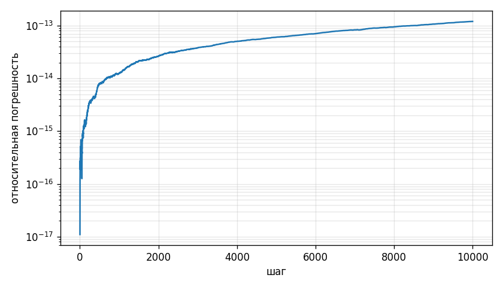

# Абсолютная и относительная погрешность

Код: `errors.py`. Запуск: `python errors.py`.

## Задача 1

| приближение | Δ | δ |
| --- | --- | --- |
| e = 2.718 | 2.8e-4 | 0.010% |
| 1/3 ≈ 0.333 | 3.3e-4 | 0.100% |
| π ≈ 3.14 | 1.6e-3 | 0.051% |
| g = 9.8 | 0.01 | 0.102% |

По абсолютной ошибке порядок качества такой: e, потом 1/3, потом π, хуже всех g. По относительной: e, π, 1/3, g. Порядки не совпали. У π абсолютная ошибка больше, чем у 0.333, но само число больше, поэтому доля ошибки меньше. Абсолютная погрешность смотрит на разницу в единицах величины, относительная на долю от точного значения.

## Задача 2

Мост: Δ = 3 м, δ = 0.24%. Болт: Δ = 0.3 мм, δ = 3%.

По абсолютной ошибке «больше» промах у моста, но метры и миллиметры так сравнивать нельзя. По относительной сильнее ошибся замер болта, там 3% против 0.24%. Какая погрешность важнее, зависит от того, что мы сравниваем: размер промаха или его долю.

## Задача 3

`relative_error` считает |approx − exact| / |exact|. Если exact равен нулю, возвращает `inf`, деления на ноль нет. На парах из задачи 1 функция даёт те же доли: e 1.0e-4, π 5.1e-4, 1/3 1.0e-3, g 1.0e-3.

## Задача 4

Если |47.3 − x*| / |x*| ≤ 0.001, то x* лежит между 47.3/1.001 и 47.3/0.999. Это интервал [47.25, 47.35].

## Задача 5

У датчика B абсолютная ошибка это |T| · 0.5%. Она не больше 0.3 °C, пока |T| ≤ 60 °C. Ниже 60 °C по абсолютной ошибке лучше B, выше уже лучше A с его фиксированными 0.3 °C. Поэтому датчик выбирают под диапазон, а не «вообще».

## Задача 6

- 0.004520: 4 значащие цифры, 4.520·10⁻³
- 1200: нули на конце могут быть значащими, а могут быть просто разрядом. Без степенной записи это не понять. Если значащих 4, пишут 1.200·10³
- 1.200: 4 цифры, 1.200·10⁰
- 10.03: 4 цифры, 1.003·10¹
- 0.03050: 4 цифры, 3.050·10⁻²
- 250000: та же путаница с нулями на конце. Если все шесть значащие, это 2.50000·10⁵

Неоднозначны целые с нулями на конце, 1200 и 250000. По такой записи не видно, нули измерили или просто дописали до разряда.

## Задача 7

Погрешность 0.02 сидит в сотых, поэтому честная запись 4.74 ± 0.02. Значащих цифр осталось три. Запись 4.738291 ± 0.02 врёт: цифры после сотых меньше самой погрешности, их всё равно нельзя узнать из этого измерения.

## Задача 8

`round` в Python даёт 0, 2, 2, 4, 0, −2, −2. Половина округляется к ближайшему чётному, а не «всегда вверх». На миллионе чисел вида k+0.5, k от 0 до 9, округление всегда вверх дало сумму на 499931 больше, чем banker's rounding. Это примерно +0.5 на каждое чётное k. В деньгах такой сдвиг копится в одну сторону, поэтому там так не округляют.

## Задача 9

Сумма 1/k от 1 до 100 без промежуточного округления совпала с `math.fsum`. К точному значению у неё Δ ≈ 3.7·10⁻¹⁶. Если каждое слагаемое заранее округлять до трёх знаков после запятой, Δ ≈ 1.4·10⁻³, это примерно на 12 порядков хуже. Промежуточное округление лучше не делать: один раз в конце, и до разряда реальной погрешности.

## Задача 10

`0.1 + 0.2` печатается как 0.30000000000000004. Сравнение через `==` с 0.3 даёт False, `math.isclose` даёт True. Δ ≈ 5.6·10⁻¹⁷, δ ≈ 1.9·10⁻¹⁶.

0.1 в двоичной записи это бесконечная дробь, как 1/3 в десятичной. В float хвост обрезают. У 0.2 тот же обрез, и сумма двух обрезанных чисел чуть не доезжает до того float, которым записали 0.3.

## Задача 11

`(1 + 1e-15) - 1` получилось 1.11·10⁻¹⁵, а не 10⁻¹⁵. Относительная ошибка около 11%. Рядом с единицей шаг float около 2·10⁻¹⁶, и такое маленькое прибавление уже плохо различимо.

Меньший корень x² + 10⁸x + 1 = 0. Плохая формула (−b + √(b² − 4ac)) / 2a вычитает два близких числа и даёт −7.45·10⁻⁹, ошибка 25%. Запись через 2c / (−b − √(b² − 4ac)) даёт −1·10⁻⁸ и на этом примере совпала с эталоном Decimal.

## Задача 12

Миллион слагаемых 0.1, эталон 100000.

| способ | Δ | δ |
| --- | --- | --- |
| цикл | 1.3·10⁻⁶ | 1.3·10⁻¹¹ |
| sum | 0 | 0 |
| fsum | 0 | 0 |

Ручной цикл здесь хуже. `sum` и `math.fsum` попали в 100000. На длинной сумме лучше не складывать вручную в один float-накопитель.

## Задача 13

Половина чисел 10⁻¹⁰, половина 10⁶. Если сначала сложить маленькие, сумма совпала с `fsum`: 500000000000.00006. Если сначала большие, маленькие пропадают, Δ ≈ 6·10⁻⁵. Маленькое число меньше шага float рядом с большой суммой, и прибавление его не меняет результат. Сначала имеет смысл копить мелкие, а для надёжности брать `fsum`.

## Задача 14

Тысяча умножений на 1.0001, эталон считал в Decimal. После 10000 шагов относительная ошибка 1.2·10⁻¹³. Пороги 10⁻⁹, 10⁻⁶ и 10⁻³ за эти шаги не достигнуты: каждый шаг добавляет ошибку порядка машинного эпсилон, и за 10000 шагов это ещё мало. На графике видно, что ошибка всё же растёт. В длинной цепочке умножений она и дальше будет копиться.

## Задача 15

Миллион раз прибавил 0.01 рубля. Должно выйти 10000 руб.

Float дал 10000.0000001719, расхождение 1.7·10⁻⁷ руб, это 1.7·10⁻⁹%. Decimal с 28 знаками и учёт в целых копейках (1_000_000 копеек) дали ровно 10000. Для бухгалтерии правильны они: копейка это целое, а float копит дробный мусор. Поэтому деньги в float не считают.
