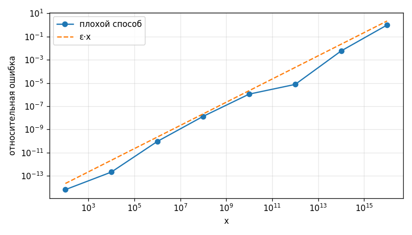

# Устойчивость алгоритма

Код: `stability.py`. Запуск: `python stability.py`. Это отдельная работа, не про погрешности из другого файла.

Эталон, где нужна длинная точность, считал через `mpmath` или `Decimal` на 50 знаках.

## Задача 1

Число обусловленности |x·f'(x) / f(x)|:

| функция | точка | cond |
| --- | --- | --- |
| sin x | π/2 | 0 (в float вышло ~10⁻¹⁶) |
| √x | 10⁻⁸ | 0.5 |
| ln x | 1.001 | 1000.5 |
| x − 1 | 1.000001 | 1.000001·10⁶ |

По возрастанию: sin, корень, логарифм, x−1. Самая неприятная это x−1 рядом с единицей. Маленький сдвиг x почти целиком переходит в ответ, а сам ответ крошечный, поэтому относительная ошибка огромная. У синуса в π/2 производная нулевая, маленький сдвиг x ответ почти не меняет.

## Задача 2

Для f = a − b обусловленность по a это |a / (a − b)|, по b это |b / (a − b)|. Когда a почти равно b, знаменатель маленький и оба числа большие.

Проверка: a = 1 + 10⁻⁸, b = 1, сдвиг a на 10⁻⁹. По формуле cond ≈ 10⁸. Посчитанное |Δf/f| / |δa/a| тоже 10⁸. Абсолютно ответ сдвинулся ровно на δa, производная равна 1. Плохо тут именно относительное: крошечная доля изменения a даёт десятки процентов изменения разности.

## Задача 3

Уравнение x² − 2x + (1 − ε) = 0. Корень уезжает от 1 на √ε.

| ε | сдвиг корня | во сколько раз сдвиг меньше предыдущего |
| --- | --- | --- |
| 10⁻² | 0.1 | |
| 10⁻⁴ | 0.01 | 10 |
| 10⁻⁶ | 0.001 | 10 |

ε каждый раз меньше в 100 раз, сдвиг только в 10. У кратного корня сдвиг идёт как корень из возмущения, задача плохо обусловлена: маленькая правка коэффициента заметно двигает корень.

## Задача 4

Задача: посчитать e⁻²⁰. Обусловленность здесь |x| = 20, это ещё нормальная задача, входная относительная ошибка растягивается в 20 раз.

Неустойчивый способ: ряд Тейлора. Слагаемые сначала огромные, потом взаимно съедаются, в float от ряда осталось 6.15·10⁻⁹. `math.exp(-20)` даёт 2.06·10⁻⁹, относительная ошибка ряда около 2. Проблема не в задаче, а в алгоритме: ряд вычитает близкие большие числа. Устойчивый способ считает экспоненту без этого сокращения.

## Задача 5

Меньший корень x² + bx + 1 = 0.

| b | ошибка плохой формулы | ошибка хорошей |
| --- | --- | --- |
| 10⁴ | 1.1·10⁻⁹ | 0 |
| 10⁸ | 0.25 | 0 |
| 10¹² | 1 (корень стал 0) | 0 |

Плохая формула (−b + √(b² − 4ac)) / 2a начинает сильно врать около b = 10⁸: под корнем вычитание 4 уже теряется на фоне b². При b = 10¹² корень просто 0, ошибка 100%. Хорошая формула 2c / (−b − √(b² − 4ac)) на всех трёх b попала в эталон.

## Задача 6

(1 − cos x) / x².

| x | ошибка «в лоб» | ошибка через 2·sin²(x/2) / x² |
| --- | --- | --- |
| 10⁻² | 2.9·10⁻¹³ | 1·10⁻¹⁶ |
| 10⁻⁴ | 5.2·10⁻⁹ | 1·10⁻¹⁶ |
| 10⁻⁶ | 8.9·10⁻⁵ | 0 |
| 10⁻⁸ | 1 | 0 |
| 10⁻¹⁰ | 1 | 0 |

Ошибка плохого способа переходит через 1% при x = 10⁻⁸: cos x в float уже становится 1, и числитель обнуляется. Пока x не такой маленький, тождество не обязательно, но как только 1 и cos x перестают отличаться в разрядах float, без тождества считать нельзя.

## Задача 7

√(x+1) − √x против 1 / (√(x+1) + √x).

Плохой способ: при x = 10⁴ ошибка 2·10⁻¹³, при 10⁸ уже 1·10⁻⁸, при 10¹² это 8·10⁻⁶, при 10¹⁴ это 6·10⁻³, при 10¹⁶ результат 0 и ошибка 100%. По точкам показатель роста около 1.1, то есть ошибка растёт почти пропорционально x. Хорошая формула на этих x остаётся на уровне машинного эпсилон. Вычитать два близких корня при большом x не стоит, разность лучше сразу рационализировать.

## Задача 8

| x | ошибка log(1+x) | ошибка log1p |
| --- | --- | --- |
| 10⁻² | 9·10⁻¹⁶ | 0 |
| 10⁻⁸ | 6·10⁻⁹ | 0 |
| 10⁻¹² | 9·10⁻⁵ | 0 |
| 10⁻¹⁶ | 1 | 0 |

`math.log1p(x)` считает ln(1+x), не складывая 1+x в обычном float. При x = 10⁻¹⁶ сумма 1+x в float равна 1, обычный логарифм даёт 0. `log1p`, `expm1` и `hypot` как раз закрывают такие сокращения, чтобы их не писать руками и не промахнуться.

## Задача 9

Гармоническая сумма, эталон `mpmath.harmonic`.

| n | ошибка цикла | ошибка sum | ошибка fsum |
| --- | --- | --- | --- |
| 10⁵ | 7.6·10⁻¹⁵ | 0 | 0 |
| 10⁶ | 5.1·10⁻¹⁴ | 0 | 0 |
| 10⁷ | 1.5·10⁻¹³ | 0 | 0 |

Ручная сумма портится с ростом n, но медленнее, чем само n: от 10⁵ до 10⁷ n вырос в 100 раз, ошибка примерно в 20. Порог 10⁻¹⁰ на этом диапазоне не достигнут, при 10⁷ ошибка ещё 1.5·10⁻¹³. `sum` и `fsum` здесь совпали с эталоном в пределах float. Для совсем длинных сумм надёжнее `fsum`, цикл с одним накопителем уже начинает отъезжать.

## Задача 10

Та же функция, что в задаче 6. Три отдельных причины ошибки:

| что менял | что вышло |
| --- | --- |
| x от 10⁻² до 10⁻⁸, алгоритм плохой | ошибка с 3·10⁻¹³ до 1, около 13 порядков. Это сокращение 1 − cos x |
| тип числа при x = 10⁻³ | float32 ошибся на 5·10⁻², float64 на 2·10⁻¹¹. Разница около 9 порядков, это шаг сетки float |
| алгоритм при x = 10⁻⁸ | плохой дал ошибку 1, хороший 0. Это уже устойчивость формулы, не свойство задачи |

В (а) доминирует потеря разрядов при вычитании. В (б) доминирует точность типа. В (в) доминирует выбор формулы.

## Задача 11

Два варианта плохой формулы меньшего корня при b = 10¹⁶: через `math.sqrt` и через `** 0.5`. Оба дали 0.0 и поэтому равны друг другу. Эталон −10⁻¹⁶, относительная ошибка 100%. Сравнение float с float тут сказало бы «всё сошлось». Без отдельного эталона такую ошибку не заметить.

## Задача 12

√(x+1) − √x на сетке от 10² до 10¹⁶, восемь точек. Наклон на log-log получился 1.01. Теория «ошибка ≈ ε·x» даёт наклон 1, по графику это та же прямая. По одной точке, например x = 100, ошибка 7·10⁻¹⁵ и кажется, что формула нормальная. На большом x она разваливается. Диапазон это и показывает.

## Задача 13

Python 3.13.14, numpy 2.3.5.

10⁵ чисел `random.random` при seed 42. Два запуска дали одно и то же: sum, fsum и numpy.sum совпали, 50014.42921162781. При seed 43 все три снова совпали между собой, но сумма уже другая: 50095.68089589526. На таких ровных числах из (0, 1) разницы методов не видно, она меньше одного шага float.

Чтобы разница методов вообще проявилась, из `default_rng` собрал второй ряд: чередование ±2⁵³ плюс небольшой шум. Seed 42: sum и fsum дали 527, numpy.sum дал −96. Seed 43: 13 и 784. Повтор с тем же seed воспроизводит те же числа, другой seed меняет и сумму, и зазор между способами. Зазор не случайный сбой запуска, он сидит в алгоритме. Без записанного seed и версий это не повторить.

## Задача 14

| набор | sum | fsum |
| --- | --- | --- |
| два числа 10³⁰⁰ | 2·10³⁰⁰ | 2·10³⁰⁰ |
| два числа 10⁻³⁰⁰ | 2·10⁻³⁰⁰ | 2·10⁻³⁰⁰ |
| 0 и 1 | 1 | 1 |
| два денормала 10⁻³²⁰ | 2·10⁻³²⁰ | 2·10⁻³²⁰ |
| 10⁻³²⁰ + 1 | 1 | 1 |
| inf и 1 | inf | inf |
| inf и −inf | nan | ValueError |
| nan и 1 | nan | nan |
| всё вместе, включая nan | nan | nan |

Обычные большие, маленькие и ноль оба способа переваривают. Денормал сам по себе сохраняется, но прибавление его к единице теряется: он меньше шага float около 1. NaN сразу портит и `sum`, и `fsum`. `sum` от inf и −inf молча даёт nan, `fsum` на этом падает. В реальном коде nan и inf лучше ловить до суммы и не тащить их в расчёт.

## Задача 15

Цель: проверить √(x+1) − √x на диапазоне, а не в одной точке.

Постановка: плохой способ это прямая разность корней, хороший это 1 / (√(x+1) + √x). Эталон: `Decimal` на 50 знаках. Сетка логарифмическая, 8 точек от 10² до 10¹⁶.

| x | плохой | хороший | эталон | δ плохого | δ хорошего |
| --- | --- | --- | --- | --- | --- |
| 10² | 4.99·10⁻² | 4.99·10⁻² | 4.99·10⁻² | 6.5·10⁻¹⁵ | 0 |
| 10⁴ | 5.00·10⁻³ | 5.00·10⁻³ | 5.00·10⁻³ | 2.1·10⁻¹³ | 0 |
| 10⁶ | 5.00·10⁻⁴ | 5.00·10⁻⁴ | 5.00·10⁻⁴ | 9.3·10⁻¹¹ | 0 |
| 10⁸ | 5.00·10⁻⁵ | 5.00·10⁻⁵ | 5.00·10⁻⁵ | 1.4·10⁻⁸ | 1·10⁻¹⁶ |
| 10¹⁰ | 5.00·10⁻⁶ | 5.00·10⁻⁶ | 5.00·10⁻⁶ | 1.1·10⁻⁶ | 0 |
| 10¹² | 5.00·10⁻⁷ | 5.00·10⁻⁷ | 5.00·10⁻⁷ | 7.6·10⁻⁶ | 2·10⁻¹⁶ |
| 10¹⁴ | 5.03·10⁻⁸ | 5.00·10⁻⁸ | 5.00·10⁻⁸ | 5.8·10⁻³ | 0 |
| 10¹⁶ | 0 | 5.00·10⁻⁹ | 5.00·10⁻⁹ | 1 | 0 |

Плохой способ устойчив примерно до x = 10⁶, там ошибка ещё около 10⁻¹⁰. Дальше два корня в float слишком близки, при x = 10¹⁶ разность становится нулём. Хорошая формула на всей сетке держит ошибку не хуже 10⁻¹⁶. Достижимая точность здесь это обычный float, если не вычитать близкие корни.
