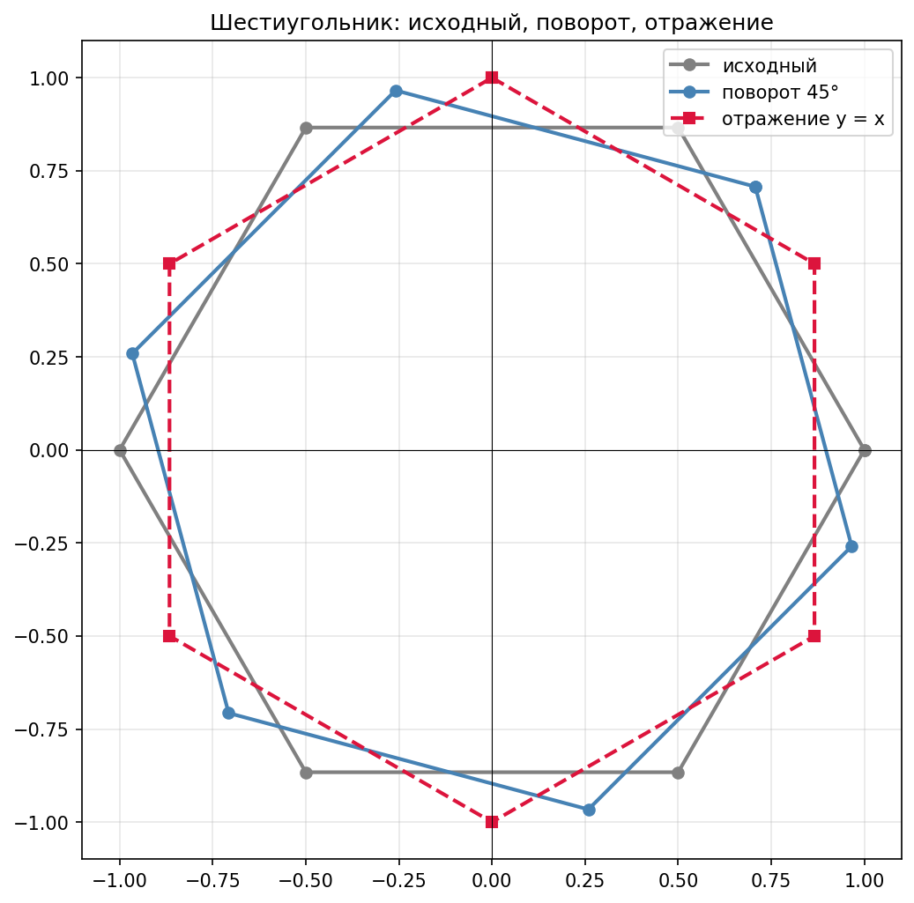
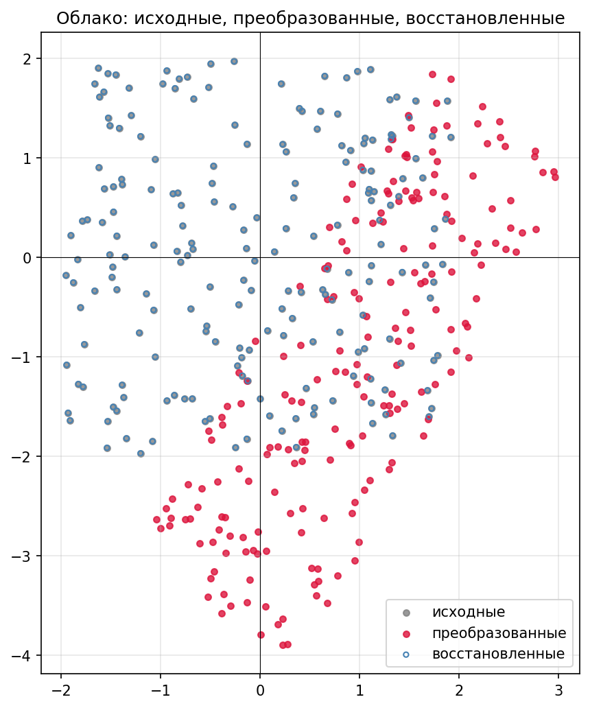

# Задачи 1 и 2

## Задача 1. Поворот и отражение шестиугольника

Правильный шестиугольник с центром в нуле и радиусом 1. Вершины `cos(2πk/6)`, `sin(2πk/6)`, контур замкнут. Поворот на 45° против часовой и отражение исходного относительно прямой y = x.



Почему отражённый выглядит повёрнутым. Матрица отражения относительно y = x и матрица поворота на 90° отличаются только знаком:

```
отражение y = x     поворот на 90°
0  1                0  -1
1  0                1   0
```

Отражение меняет координаты местами: (x, y) становится (y, x). У правильного шестиугольника из-за симметрии вершины после этого садятся туда же, куда сел бы повёрнутый контур. Поэтому красная фигура на графике стоит вершиной вверх, как после поворота, хотя это отражение.

## Задача 2. Композиция и обратное преобразование

200 случайных точек в квадрате [−2, 2] × [−2, 2], `np.random.default_rng(42)`. Порядок: масштаб sx = 1.5, sy = 0.5, поворот на 60°, перенос на (1, −1) через однородные координаты.

Обратные преобразования в обратном порядке: перенос на (−1, 1), поворот на −60°, масштаб 1/1.5 и 1/0.5. `np.allclose` с точностью 1e−12 дал True. Максимальное расхождение с исходными точками 8.9e−16.



Почему обратный порядок. Обратная к произведению матриц — произведение обратных в обратном порядке: (ABC)⁻¹ = C⁻¹ B⁻¹ A⁻¹. Последним применялся перенос, его и надо отменять первым, потом поворот, потом масштаб.

Если те же обратные матрицы применить в прямом порядке, они не сокращаются и точки не возвращаются. `np.allclose` дал False, расхождение доходит до 5.7.
